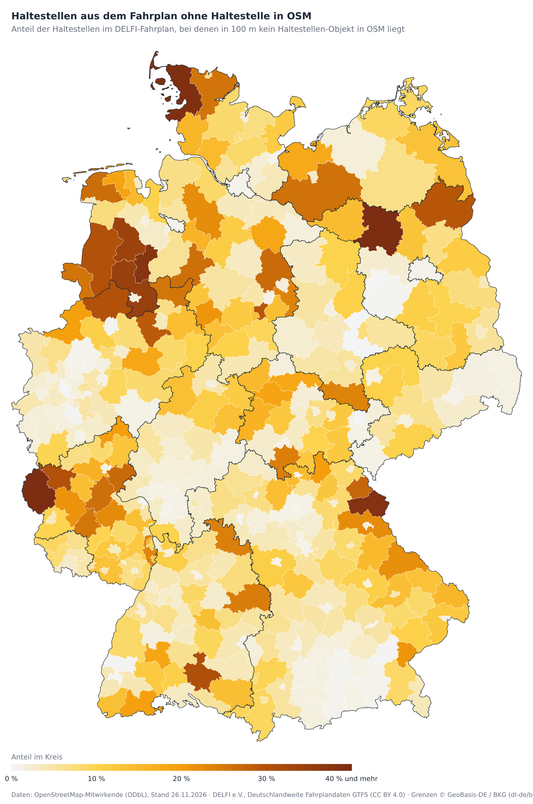

# OSM-Abgleich Deutschland

Wo OpenStreetMap in Deutschland neben offenen amtlichen Daten noch Lücken hat, Kreis für Kreis. Hausnummern, Haltestellen, Arztpraxen, Postfilialen, Kitas und Krankenhäuser, mit Listen zum Weiterarbeiten und den Skripten, mit denen sich alles nachrechnen lässt.

**Stand:** OpenStreetMap 26.11.2026 (Geofabrik, 21:21 UTC), DELFI-Fahrplan 23.11.2026, INKAR 2025, Zensus 2022, Krankenhausverzeichnis 2024.

Entstanden ist das beim Bau von [WohnData](https://wohn-data.de), einem Wohnlagen-Check, der auf OSM aufbaut. Die ausführliche Erklärung steht im [OSM-Tagebuch](https://www.openstreetmap.org/user/Adrian%20Joswowitz-Niemierski/diary/409731).

## Die wichtigsten Ergebnisse

- **Hausnummern:** 1,4 Millionen Einwohner haben in ihrer 100-Meter-Zelle und den acht Nachbarzellen keine Adresse in OSM. Bei 97 Prozent von ihnen ist in der eigenen Zelle schon ein Gebäude gezeichnet. Am größten ist die Lücke in Niederbayern und der Oberpfalz.
- **Haltestellen:** Von 239.511 angefahrenen Haltestellen im DELFI-Fahrplan liegen 91 Prozent in 100 Metern an einem Haltestellen-Objekt in OSM. 21.797 nicht.
- **Krankenhäuser:** 316 Standorte mit Notfallversorgung nach dem Krankenhausverzeichnis haben in OSM kein `emergency`-Tag. Acht geschlossene Häuser oder Notaufnahmen stehen noch ganz oder teilweise als offen in OSM.
- **Arztpraxen, Post, Kitas:** 15 Kreise mit 2,1 Mio. Einwohnern haben in OSM weniger als halb so viele Arztpraxen wie im Bundesschnitt, bei der Post sind es 19 Kreise mit 2,3 Mio. Einwohnern. Kitas sind zu 85 Prozent erfasst.



## Listen

| Datei | Inhalt |
|---|---|
| `listen/haltestellen_ohne_osm.csv` | Haltestellen aus dem Fahrplan ohne Haltestellen-Objekt in OSM in 100 m, mit Entfernung zum nächsten Objekt und Verkehrsart |
| `listen/haltestellen_kreise.csv` | Anteil je Kreis |
| `listen/adressluecken_zellen.csv` | bewohnte 100-m-Zellen ohne Hausnummer in der 3x3-Nachbarschaft, mit Zahl der Gebäude in der Zelle |
| `listen/adressluecken_kreise.csv`, `adressluecken_laender.csv` | Anteile je Kreis und Land |
| `listen/krankenhaeuser_ohne_emergency.csv` | Standorte mit Notfallstufe 1 bis 3, deren OSM-Objekt kein `emergency`-Tag hat |
| `listen/krankenhaeuser_emergency_no.csv` | dasselbe mit `emergency=no` |
| `listen/krankenhaeuser_ohne_osm.csv` | Standorte ohne Krankenhaus-Objekt in OSM in 250 m |
| `listen/krankenhaeuser_geschlossen_in_osm.csv` | geschlossene Häuser oder Notaufnahmen, die in OSM noch offen aussehen, mit Quellen |
| `listen/kita_paare.csv` | Paare von `amenity=kindergarten` unter 25 m Abstand |
| `listen/abdeckung_kreise.csv` | Zählung und Index je Kreis für Apotheken, Kitas, Post und Arztpraxen |
| `listen/supermarkt_marken.csv` | Supermärkte nach `brand` |

**Bitte nichts aus den amtlichen Daten oder dem Fahrplan in OSM kopieren.** Die Listen sind Hinweise, wo sich ein Blick vor Ort oder auf Luftbilder lohnt. Positionen im Fahrplan und Adressen im Krankenhausverzeichnis können ungenau sein, und manche Haltestelle dient nur dem Schulbus oder dem Rufbus.

Wer eine Liste abgearbeitet hat oder einen Fehler darin findet, kann gern ein Issue anlegen. Die Listen werden nach einem neuen OSM-Stand gelegentlich neu gerechnet.

## Nachrechnen

Python 3.11 oder neuer mit `osmium`, `pandas`, `geopandas`, `pyproj`, `scipy` und `openpyxl`, dazu das Programm `osmium-tool`. Für die PNG-Karten zusätzlich `playwright` mit Chromium, sonst entstehen nur SVG-Dateien.

```bash
skripte/00_extract.sh germany-latest.osm.pbf extrakte/
export OSM_POI=extrakte/poi.osm.pbf OSM_ADDR=extrakte/addr.osm.pbf OSM_BUILDINGS=extrakte/buildings.osm.pbf
export VG250=vg250_01-01.utm32s.shape.ebenen.zip
export ZENSUS_POP=Zensus2022_Bevoelkerungszahl_100m-Gitter.csv
export DELFI_GTFS=20261123_fahrplaene_gesamtdeutschland_gtfs.zip
cd skripte
python 10_abdeckung_kreise.py && python 20_adressen.py && python 30_haltestellen.py
python 40_krankenhaeuser.py && python 50_kita_paare.py && python 60_karten.py
```

Die Adress- und die Gebäudeauswertung brauchen etwa 6 GB Arbeitsspeicher.

Quellen der Eingangsdaten:

- OSM: [download.geofabrik.de](https://download.geofabrik.de/europe/germany.html)
- VG250: [BKG Open Data](https://gdz.bkg.bund.de/index.php/default/open-data/verwaltungsgebiete-1-250-000-ebenen-stand-01-01-vg250-ebenen-01-01.html)
- Zensus 2022 im 100-m-Gitter: [destatis.de](https://www.destatis.de/DE/Themen/Gesellschaft-Umwelt/Bevoelkerung/Zensus2022/_inhalt.html)
- DELFI-Fahrplan: [opendata-oepnv.de](https://www.opendata-oepnv.de) (Anmeldung nötig)
- INKAR: [inkar.de](https://www.inkar.de). Die verwendeten Kreiswerte liegen in `daten/inkar_kreise.csv`.
- Krankenhausverzeichnis: [destatis.de](https://www.destatis.de). Die Standorte mit Notfallstufe und ihrer Verortung liegen in `daten/krankenhaeuser_notfallstufe.csv`, die Schließungen mit Quellen in `daten/krankenhaus_schliessungen.csv`.

## Methode in Kürze

- Jedes OSM-Objekt zählt einmal, als Knoten oder als Mittelpunkt von Weg oder Fläche.
- Der Kreis-Index ist (OSM / amtlich im Kreis) geteilt durch (OSM / amtlich bundesweit). 1 ist der Bundesschnitt, 0,5 die Hälfte. Arztpraxen werden zweimal verglichen, mit Hausärzten und mit allen Ärzten, weil es keine amtliche Zahl der Praxen gibt.
- Haltestellen: Steige mit derselben Haltestellen-ID (DHID, erste drei Teile) sind eine Haltestelle. Gezählt sind nur Steige, die im Fahrplan angefahren werden.
- Krankenhäuser: Zuordnung im Umkreis von 250 m, ein Objekt mit `emergency=yes` hat Vorrang.
- Hausnummern: Zellen des Zensus-Gitters, Nachbarschaft 3x3.

## Lizenzen

- **Listen** in `listen/`: [Open Database License (ODbL) 1.0](https://opendatacommons.org/licenses/odbl/1-0/), weil sie aus OpenStreetMap abgeleitet sind. Namensnennung: © OpenStreetMap-Mitwirkende, dazu die Quellen unten.
- **Skripte** in `skripte/`: MIT, siehe `LICENSE`.
- **Eingangsdaten** in `daten/`: unter der Lizenz ihrer Quelle.

Quellen und Namensnennung:

- © OpenStreetMap-Mitwirkende, ODbL 1.0
- INKAR, Bundesinstitut für Bau-, Stadt- und Raumforschung (BBSR), Ausgabe 2025, Datenlizenz Deutschland Namensnennung 2.0
- Zensus 2022, Statistische Ämter des Bundes und der Länder, Datenlizenz Deutschland Namensnennung 2.0
- Krankenhausverzeichnis, Statistisches Bundesamt (Destatis), Stand 31.12.2024, Datenlizenz Deutschland Namensnennung 2.0
- Deutschlandweite Fahrplandaten (GTFS), DELFI e.V., CC BY 4.0
- Verwaltungsgebiete VG250, © GeoBasis-DE / BKG, Datenlizenz Deutschland Namensnennung 2.0
